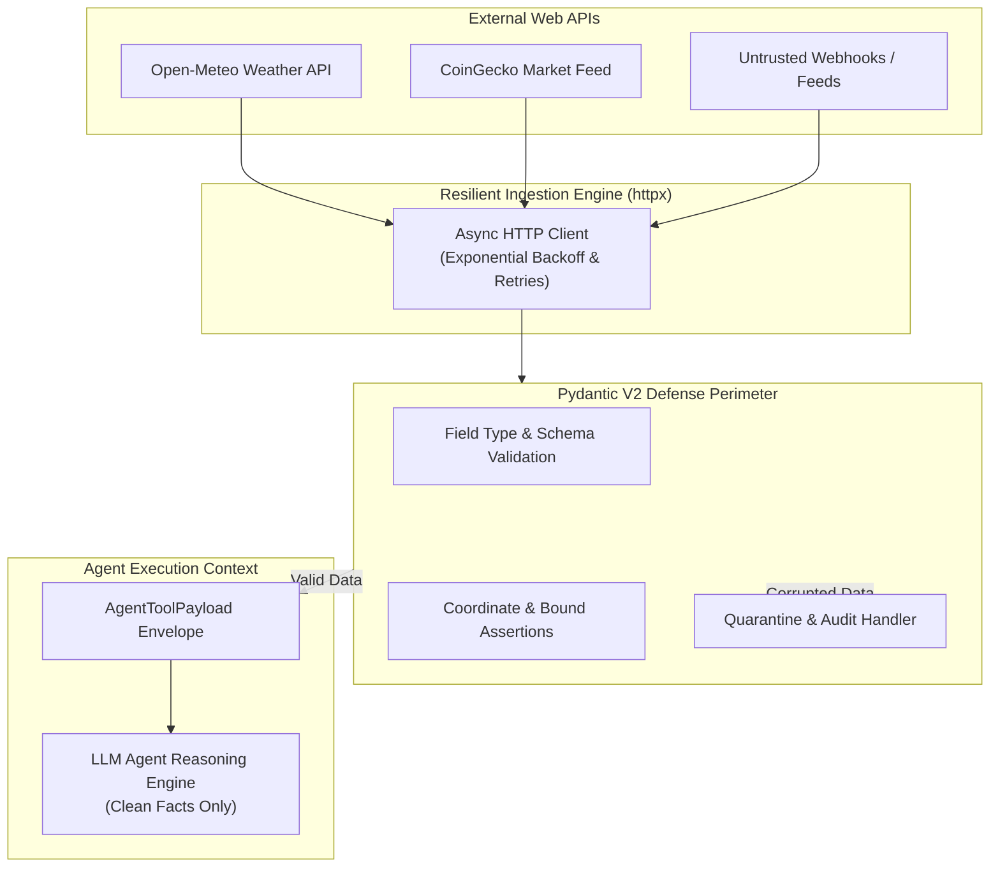

# 🛡️ Data Integrity, Pydantic V2 & Resilient HTTP APIs

[](https://www.python.org/)
[](https://docs.pydantic.dev/)
[](https://www.python-httpx.org/)
[]()
[](https://github.com/imsalmanali/data-integrity-pydantic-v2-api)

> **Production-grade data ingestion & schema validation engine for autonomous AI Agents, built with Pydantic V2 and Async HTTPX.**

---

## 🧭 My Journey & Career Sprint Milestone

I am on an intensive 11-week sprint to become a **Junior Agentic AI Engineer** (Target: Job-Ready by January 2027). 

In modern Agentic AI workflows, autonomous agents make critical decisions based on tools querying external APIs, webhooks, and third-party data feeds. If untrusted or malformed external data leaks into the LLM context window without strict validation, the agent suffers from **reasoning degradation, hallucinated tool calls, and cascading execution failures**.

This repository marks the completion of my **Phase 1 (Week 1) Milestone: Data Integrity & Production HTTP APIs**.

* **Author:** Salman Ali  
* **GitHub Profile:** [@imsalmanali](https://github.com/imsalmanali)  
* **Repository:** [https://github.com/imsalmanali/data-integrity-pydantic-v2-api](https://github.com/imsalmanali/data-integrity-pydantic-v2-api)

---

## 🎯 What This Project Solves

1. **Zero Data Leakage Boundary:** Untrusted raw JSON responses from public APIs are quarantined and parsed through strict Pydantic V2 models before reaching downstream agent memory.
2. **Physical & Financial Plausibility Bounds:** Implements custom `@field_validator` and `@model_validator` logic (e.g., rejecting negative asset prices, price drops below -100%, atmospheric temperature anomalies exceeding earth boundaries, and non-alphanumeric ticker symbols).
3. **Resilient Asynchronous HTTP Client:** Features an async HTTP client with automated exponential backoff retries, custom timeouts, and status code verification.
4. **Agent Tool Envelopes:** Normalizes multi-source external data into standard `AgentToolPayload` models with human-readable synopses optimized for LLM prompts.

---

## 🏗️ Architecture



---

## 📁 Project Structure

```text
data-integrity-pydantic-api/
├── README.md               # Project documentation & journey milestone
├── requirements.txt        # Production dependencies
├── .gitignore              # Git ignore configuration
├── src/
│   ├── __init__.py
│   ├── models/
│   │   ├── __init__.py
│   │   ├── base.py         # AgentBaseModel & TimestampedModel
│   │   ├── weather.py      # WeatherObservation & WeatherForecastRequest
│   │   ├── financial.py    # AssetQuote & MarketSummary
│   │   └── agent_payload.py# AgentToolPayload & DataIntegrityReport
│   ├── clients/
│   │   ├── __init__.py
│   │   ├── http_client.py  # ResilientHTTPClient with async retry backoff
│   │   ├── weather_client.py   # Live Open-Meteo API connector
│   │   └── financial_client.py # Live CoinGecko API connector
│   ├── pipeline.py         # AgentDataIngestionPipeline & quarantine filter
│   └── main.py             # Live execution & dirty-data simulation runner
└── tests/
    ├── __init__.py
    ├── test_models.py      # Validation bounds & schema tests
    ├── test_pipeline.py    # Batch quarantine & pipeline tests
    └── run_tests.py        # Automated test suite runner
```

---

## ⚡ Quickstart

### 1. Clone the Repository
```bash
git clone https://github.com/imsalmanali/data-integrity-pydantic-v2-api.git
cd data-integrity-pydantic-api
```

### 2. Install Dependencies
```bash
pip install -r requirements.txt
```

### 3. Run Live Ingestion Pipeline
```bash
python -m src.main
```

### 4. Run Test Suite
```bash
python tests/run_tests.py
```

---

## 📊 Live Pipeline Output Preview

```text
===========================================================================
🚀 AGENTIC AI CAREER SPRINT | MILESTONE 1
📌 Topic: Data Integrity, Pydantic V2 & Resilient HTTP APIs
👤 Engineer: Salman Ali (https://github.com/imsalmanali)
===========================================================================

🌦️ [Step 1] Ingesting Live Real-Time Weather via Open-Meteo API...
  ✅ Lahore: Current weather in Lahore: 21.5°C (Clear sky), Humidity: 80%, Wind: 4.8 km/h.
     [Status: SUCCESS] Ingested At: 2026-10-23T16:05:06.901744+00:00
  ✅ London: Current weather in London: 8.7°C (Moderate drizzle), Humidity: 85%, Wind: 26.6 km/h.
     [Status: SUCCESS] Ingested At: 2026-10-23T16:05:08.354722+00:00
  ✅ Tokyo: Current weather in Tokyo: 15.6°C (Mainly clear), Humidity: 82%, Wind: 3.3 km/h.
     [Status: SUCCESS] Ingested At: 2026-10-23T16:05:10.163808+00:00

📈 [Step 2] Ingesting Live Financial Intelligence via CoinGecko API...
  ✅ Market Ingestion: Market Status: OPEN | Assets: [BTC: $81,573.00 (-0.04%), ETH: $2,403.65 (+0.26%), SOL: $104.59 (-0.04%)] | Top Performer: ETH (+0.26%)

🛡️ [Step 3] Simulating Untrusted / Corrupted Webhook Data Stream...
  🔍 Total Records Processed: 4
  🟢 Accepted Valid Records: 1
  🔴 Quarantined / Rejected: 3
  ⚠️ Pipeline Integrity Status: PARTIAL

  📋 Quarantined Audit Trace (Sample):
    - Index 1 (FAKECOIN):
        Field 'price_usd': Input should be greater than 0
    - Index 2 (BAD$$COIN!):
        Field 'symbol': Value error, Ticker symbol 'BAD$$COIN!' must be alphanumeric.
    - Index 3 (CRASH):
        Field 'change_24h_percent': Value error, Price change cannot drop below -100% (got -150.0%).

📦 [Step 4] Final Structured Payload Dispatched to LLM Agent:
{
  "tool_name": "get_market_summary",
  "status": "SUCCESS",
  "data": { ... },
  "audit": {
    "total_received": 3,
    "valid_count": 3,
    "invalid_count": 0,
    "status": "SUCCESS"
  },
  "agent_summary": "Market Status: OPEN | Assets: [BTC, ETH, SOL]"
}

===========================================================================
✨ Pipeline executed successfully with zero data leakage!
===========================================================================
```

---

## 🧪 Key Learnings & Engineering Practices Applied

* **Pydantic V2 Model Config:** Used `model_config = ConfigDict(extra="forbid", str_strip_whitespace=True)` to prevent silent pollution.
* **Granular Validators:** Implemented `@field_validator` for format normalization and `@model_validator(mode="after")` for cross-field consistency.
* **HTTP Resilience:** Handled network jitter, connection timeouts, and exponential backoff retry cycles gracefully without blocking asynchronous execution.
* **Auditability:** Added structured auditing (`DataIntegrityReport`) allowing AI agents to understand data quality and request human-in-the-loop validation when anomalies are detected.

---

## 📜 License
MIT License. Free to use and build upon. Built with pride during the **Agentic AI Career Sprint**.
